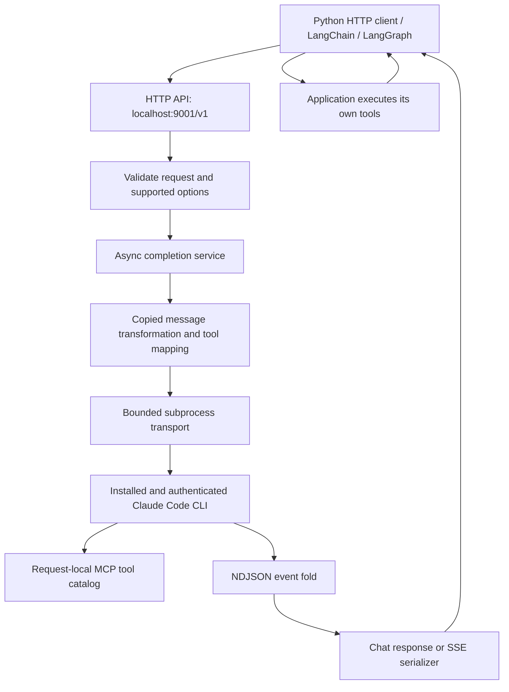

# Claude Subscription Adapter: architecture and migration plan

Status: proposed for review; implementation has not started  
Date: 11 November 2026  
Requirements: [my-docs/requirements.md](../my-docs/requirements.md)

## 1. Intended outcome

Extract the custom Claude Code CLI provider from `/Users/shakir/projects/projekts-litellm-v1` into a small, independently installable Python package named `claude-subscription-adapter`. Reuse its transport, event parsing, tool bridge, usage accounting, session support, and regression tests. Replace its LiteLLM integration with a small HTTP server and local protocol types.

The server will listen on `http://localhost:9001` by default, with client API base URL `http://localhost:9001/v1`. Host and port will be configurable. Applications select the model in each request. Python, LangChain, and LangGraph applications retain ownership of their tools and execute them through their normal tool loops.

“Open API standards” is interpreted here as an **OpenAI-compatible Chat Completions interface**. The service will also expose an OpenAPI schema describing its supported endpoints. This does not imply support for every OpenAI endpoint or every model parameter.

This document is the review deliverable requested by the requirements. Code migration follows the user's review. Package publication is a later release step, not part of seeding this document.

## 2. Source inspected and findings

Source checkout HEAD: `801fcf0af09a85f6c3b9616e36e0cd6ed9ce743d`. No working-tree changes were reported in the provider or its matching tests at inspection time. The source was inspected in place without modifying it.

The implementation is in `litellm/llms/claude_code_cli/`: ten Python files, approximately 2,187 lines. Its tests and five NDJSON fixtures are in `tests/test_litellm/llms/claude_code_cli/`.

The older source document `_bmad-output/planning-artifacts/architecture-claude-code-cli-provider.md` describes tool calling as deferred. The current implementation already includes it; current code is the migration baseline.

**Deployment evidence supplied by the owner:** the Claude Code VS Code extension was configured to use this provider through projekts-litellm and was successfully used by 20 people. The owner reports that it worked extremely well and is well tried and tested. Treat this as an established working implementation, not an experimental provider whose basic viability needs to be proved again. This deployment evidence does not by itself specify coverage of every optional API parameter or the new standalone Python/LangChain/LangGraph integrations.

**Migration rule:** copy first and preserve behavior. Change package boundaries, dependencies and HTTP integration as necessary. Change provider semantics only to resolve a demonstrated extraction regression or a concrete requirement of the requested clients. Code-inspection observations below describe implementation choices and compatibility boundaries; they are not reports of failures in the deployed system.

| Existing behavior | Evidence in source | Migration implication |
| --- | --- | --- |
| Async completion and streaming; synchronous provider methods explicitly reject calls | `handler.py`, `ClaudeCodeCLI` | Keep an async server. Synchronous Python HTTP clients still work without a synchronous subprocess engine |
| Caller tools are advertised through a temporary MCP server | `tools.py`, `client_tools_server.py` | Copy this bridge; do not replace it with prompt-based JSON tool generation |
| MCP tool execution waits indefinitely; the handler stops the CLI when it sees the completed caller-tool turn | `client_tools_server.py:build_server`, `handler.py:_fold_run`, `streaming.py:_fold_stream_event` | Preserve handoff and prove cancellation cleans up both CLI and MCP descendants |
| Original tool names are recovered from MCP aliases; multiple calls are collected before handoff | `tools.py:caller_name`, `streaming.py:_caller_tool_calls` | Preserve names, IDs, argument JSON, call ordering and deduplication |
| Tool calls and results in input history become descriptive text | `transformation.py:_render_call`, `_to_turn` | Preserve the working representation and verify equivalent round trips after extraction |
| `tool_choice="none"` suppresses tools; `required` and named choices are not enforced in this module | `tools.py:read_client_tools` | Preserve baseline behavior; evaluate stronger guarantees separately against client requirements |
| Invalid tool definitions are silently skipped | `tools.py:_read_tool` | Preserve baseline acceptance behavior; stricter validation is a separate compatibility decision |
| Requested token limits can increase, but cannot reduce, the configured cap | `handler.py:_apply_request_options` | Do not advertise ordinary maximum-token semantics without fixing or explicitly rejecting unsupported limits |
| Other model controls are silently dropped | `handler.py:_apply_request_options` | Document the existing policy; avoid breaking working clients through newly strict rejection |
| Text deltas, assistant snapshots, search events and usage share one event fold | `streaming.py` | Reuse the fold; replace LiteLLM-specific chunk construction with wire serialization |
| Built-in WebSearch is always enabled | `transport.py:build_process_args` | Preserve the existing default during extraction |
| Session resume is optional and uses a process-local store plus CLI transcripts | `sessions.py`, `handler.py:_prepare` | Preserve as an opt-in optimization; ordinary client requests must work statelessly |

The deployment experience establishes the source's practical baseline. The copied tests and targeted integration checks will establish that removing LiteLLM and adding packaging has preserved it. No source tests or live CLI calls were executed while preparing this document; the deployment evidence above comes from the owner.

## 3. Compatibility contract

The first release must support text chat and application-defined **function tools**, including multi-step tool loops, multiple tool calls in a turn, streaming and non-streaming responses, synchronous and asynchronous HTTP clients, and caller-selected models. Tool correctness is a release requirement, not a deferred feature.

“All tool calls” means all valid application function tools within the published schema contract. Their implementations may access files, databases, APIs, or other resources because they run in the client application. This does not require the adapter to implement vendor-hosted tools, arbitrary custom tool protocols, or every OpenAI API feature.

| Surface | Planned contract |
| --- | --- |
| `POST /v1/chat/completions` | Required `model` and `messages`; one choice; text and function-tool outputs; optional SSE streaming |
| `GET /v1/models` | OpenAI-shaped list of operator-configured model IDs/aliases; not an assertion of account entitlement |
| `GET /health` | Process liveness, without making a model call |
| `GET /ready` | CLI availability and supported authentication-status probe; no inference call and no credential disclosure |
| `GET /openapi.json` | Actual supported request and response schema |
| Messages | System, developer, user, assistant, and tool roles; text strings and text parts; assistant tool calls and associated results |
| Tools | Function definitions, descriptions and supported JSON schemas; IDs and original names preserved |
| Tool choice | Preserve existing handling; do not claim stronger `required`/named enforcement without specific evidence |
| Parallel calls | Preserve multiple-call collection and correlation; evaluate any requested single-call constraint separately |
| Streaming | Valid completion chunks with stable response identity, indexed tool-call deltas, terminal finish reason, optional usage and `[DONE]` |
| Usage | CLI-reported counts and cache details when available; no invented billing estimate |
| Unsupported features | Document inherited option handling; reject unsupported new endpoints without imposing speculative breaking changes on working requests |

Responses, embeddings, audio, image generation, batch processing, and a general provider router are outside the initial scope. Structured output, sampling controls, strict schema enforcement and exact output-token limits must not be labeled supported merely because their request fields parse successfully.

First establish parity with the working provider and complete the required client tool loops. Stronger guarantees for required/named tool selection or single-call enforcement are separate extensions when a concrete client scenario needs them. Do not turn unverified optional capabilities into blockers for a faithful extraction, or claim broader API equivalence than has been demonstrated.

## 4. Runtime architecture



The CLI owns upstream authentication. The adapter invokes the installed binary using argument arrays, not shell interpolation. It never extracts subscription tokens or reimplements Anthropic authentication. Each installation uses the local user's existing CLI login.

Use one ASGI worker initially. Its event loop owns the concurrency limiter, queue, session store and cleanup tasks. Multiple workers would otherwise multiply limits and split session state. No Redis, database, dashboard, LiteLLM runtime, or background job system is needed.

### Request and tool lifecycle

1. Validate the request, tool schemas, tool names, tool-choice policy, model and message/tool-result relationships before starting a child process.
2. Build the CLI input using copied conversion logic. In default stateless mode, send the supplied history and disable session persistence.
3. For caller tools, write a temporary schema file and configure only the request-local MCP catalog. Keep tool alias mappings for the entire request.
4. Acquire a bounded run slot. Spawn the CLI with the requested model, neutral working directory and isolated settings. Read its event stream.
5. For ordinary output, emit text deltas or assemble a response through the same event fold.
6. For caller tools, gather the complete turn's calls. Stop and reap the subprocess tree, then finish with `finish_reason="tool_calls"`. The MCP stub must never execute the tool.
7. The client executes the functions and appends the assistant message and `role="tool"` results keyed by `tool_call_id`. The next request continues the loop through the same endpoint.
8. On completion, timeout, cancellation, client disconnect or failure, release the slot and remove temporary files. Server shutdown cancels active requests and reaps children.

Tool deltas may initially contain complete arguments in one chunk because the source learns caller calls from assistant snapshots. Incremental argument-token streaming is not required for the first release, but valid SDK reconstruction is.

## 5. What to copy and what to replace

All source paths below are relative to `/Users/shakir/projects/projekts-litellm-v1`. Target module names are under `src/claude_subscription_adapter/`.

| Source | Target | Treatment |
| --- | --- | --- |
| `litellm/llms/claude_code_cli/transport.py` | `transport.py` | Copy subprocess, NDJSON, temporary-file and admission logic; replace logging; check lifecycle preservation |
| `.../transformation.py` | `transformation.py` | Copy conversion functions; replace `AllMessageValues`; validate history fidelity before extending representation |
| `.../streaming.py` | `streaming.py` | Copy event fold, deduplication, tool extraction, finish selection and usage precedence; remove LiteLLM chunk/types imports |
| `.../tools.py` | `tools.py` | Copy MCP catalog, aliases and name recovery; preserve input handling and test name mapping |
| `.../client_tools_server.py` | `client_tools_server.py` | Copy catalog-only stdio server; preserve lightweight startup with the installed environment's Python |
| `.../usage.py` | `usage.py` | Copy counter normalization and cache accounting; return local typed usage |
| `.../errors.py` | `errors.py` | Copy failure classification; replace `CustomLLMError` with local failures and HTTP mapping |
| `.../sessions.py` | `sessions.py` | Copy optional session bookkeeping and sweep; replace logging and preserve identity/resume behavior |
| `.../handler.py` | `service.py` | Extract preparation, shared event loop, handoff and session updates; remove `CustomLLM`, singleton and LiteLLM dispatcher signatures |
| `.../__init__.py` | `__init__.py` | Replace broad provider registration exports with a minimal package API |
| `tests/test_litellm/llms/claude_code_cli/` | `tests/unit/` and `tests/fixtures/` | Copy relevant tests and all five fixtures, adapting imports/types and intentional behavior changes |

New code is limited to `api.py` for routes/SSE, `schemas.py` for local protocol models, `config.py` for server configuration, and `cli.py`/`__main__.py` for startup. Keep related HTTP serialization in `api.py` until its size warrants a split.

Do not copy provider registries, model pricing tables, proxy routing, enterprise modules, dashboard code, Prisma, database migrations, telemetry integrations or the entire source dependency set. Copy small helper behavior such as finish-reason mapping only after inspecting its exact implementation and tests.

Record source paths, revision and intentional deviations in `project-docs/migration-manifest.md` during migration. Preserve applicable source MIT notices in the distributed license/notice files; the inspected root license distinguishes enterprise content, which this extraction does not need.

## 6. Required retrofit work

### Remove LiteLLM coupling

Replace `ModelResponse`, `Message`, `Choices`, `GenericStreamingChunk`, `Usage`, OpenAI type aliases, `map_finish_reason`, `CustomLLMError`, and `verbose_logger` with small local types, a narrow mapping function and standard logging. Do not recreate LiteLLM's generic provider framework.

The server serializer must supply fields previously added by LiteLLM: response ID, object type, creation time, model, choice index, assistant role, finish reason and valid SSE envelopes. Usage-only chunks are emitted only when requested. Internal web-search progress must not appear as answer text.

### Tool and history fidelity

Keep the MCP bridge as the primary mechanism. Carry over its existing tests and add focused integration checks for empty/nested schemas, Unicode arguments, multiple calls and repeated tool rounds. Investigate invalid-name, alias-collision and result-correlation edge cases if tests or required clients expose an issue. Do not change working input handling merely to make the extraction stricter.

The source serializes the conversation as a JSON array over stdin without an explicit structured input-format flag, and flattens tool history to text. Preserve this representation: it is part of the working implementation. Compare complete tool round trips before and after extraction. Change this boundary only if a reproducible regression or a required client scenario demonstrates a need; do not redesign it based on its unconventional representation alone.

Do not claim `strict=true` or forced tool selection through prompt instructions alone. Enforce what can be validated and fail clearly when a requested guarantee cannot be supplied. Never fabricate a tool call to satisfy a requested choice.

### Process lifecycle and resource bounds: preserve first, improve on evidence

Copy the source's queue, timeout and cleanup behavior first. Its timeout starts after queue acquisition, stderr is collected after stdout, and events are retained for failure classification. These are review observations, not observed deployment failures. An overall deadline, concurrent bounded stderr drain and bounded event retention are potential follow-ups if targeted tests show a concrete need; they are not prerequisites for copying the provider.

Retain the source's large-line regression coverage and 64 MiB reader limit initially. Verify that replacing LiteLLM's wrapper preserves error and completion handling, including malformed/truncated streams. Fix demonstrated regressions without silently changing source limits.

The source kills and waits for the direct child. Verify process-group cleanup for the MCP descendant as well, including early tool handoff. Test supported platforms explicitly; do not advertise Windows support based only on the existing Windows prompt-file branch.

### Sessions

Preserve the source's stateless path when no session key is supplied, and its existing optional resume behavior when one is supplied. Map the metadata previously forwarded by LiteLLM explicitly at the new HTTP boundary. Include LangGraph checkpoint replay in integration checks.

Copy existing session-key derivation, prompt compatibility checks, history accounting and cleanup first. Verify that extraction preserves separation between conversations and behavior on failure or missing transcripts. Broader identity keys and whole-request session locking are follow-ups only if a concrete concurrency or isolation test demonstrates the need.

Cleanup may delete only transcripts created and tracked by this adapter. The proposed inactivity default retains the source's four hours. A server restart loses in-memory mappings and must fall back safely to full-history operation.

## 7. Packaging, installation and configuration

Use a `src/` package, `pyproject.toml`, a wheel/sdist build and a console entry point named `claude-subscription-adapter`. Proposed minimum Python is 3.11, consistent with the source's `asyncio.timeout_at` use. Verify the final dependency constraints against that minimum during packaging.

Direct runtime dependencies: FastAPI, Uvicorn, Pydantic and MCP. Use standard-library `argparse` for the small CLI. MCP remains a runtime dependency because application tools are a core requirement. The source declares `mcp>=2.2.0,<3` in its MCP extra; test the copied server against the chosen version instead of assuming compatibility with older MCP APIs. Pin tested development versions in the lockfile and publish appropriate dependency ranges.

OpenAI's Python client, HTTPX, LangChain and LangGraph belong in test/example dependency groups, not the server runtime. Consumers can use their existing HTTP clients without installing this package in each application.

The following commands describe the **proposed published interface**, not an already available PyPI package:

```bash
uv tool install claude-subscription-adapter
claude-subscription-adapter serve
claude-subscription-adapter serve --port 9100

# Run without a persistent tool installation
uvx claude-subscription-adapter serve --port 9001

# Install into a project when embedding or managing it with that project
uv add claude-subscription-adapter
uv run claude-subscription-adapter serve
```

Recommend `uv tool install` for the standalone server because it gives the command its own environment. `uv add` is appropriate for a project dependency. These choices follow [uv's tool installation model](https://docs.astral.sh/uv/guides/tools/). Installing the package does not start a background daemon; `serve` starts a foreground server with normal shutdown handling.

| Setting | Proposed default | Notes |
| --- | --- | --- |
| `--host` / `CSA_HOST` | `127.0.0.1` | Local access; examples use `localhost` |
| `--port` / `CSA_PORT` | `9001` | Validate range and report bind failures clearly |
| `CLAUDE_CODE_PATH` | `claude` | Retain existing environment name |
| `CLAUDE_CODE_CWD` | Adapter-owned neutral directory | Avoid inheriting a client/source repository |
| `CLAUDE_CODE_TIMEOUT_SECONDS` | `600` | Preserve the source's execution timeout semantics |
| `CLAUDE_CODE_MAX_OUTPUT_TOKENS` | `32000` | Internal CLI cap; not a promise of exact client token-limit semantics |
| `CLAUDE_CODE_MAX_CONCURRENCY` | `4` | One worker; preserve existing default |
| `CLAUDE_CODE_MAX_QUEUE_LENGTH` | `20` | Reject excess requests with retry guidance |
| `CLAUDE_CODE_SESSION_INACTIVITY_WINDOW_SECONDS` | `14400` | Applies only to opt-in sessions |
| Web search | Enabled | Preserve the source default; an optional disable switch can be added separately |
| `CSA_API_KEY` | Unset | Optional bearer token locally; require it for non-loopback binding |

CLI flags override environment settings, which override defaults. Models are supplied per request and passed to `--model`; optional configured aliases map to actual CLI model IDs. Do not silently substitute models or hardcode a supposedly current model catalogue.

The user installs and authenticates Claude Code separately as the same OS user running the service. Startup/doctor checks should inspect the installed version and supported flags; copied flags such as `--autocompact` need verification. The [Claude Code CLI reference](https://code.claude.com/docs/en/cli-reference) documents model selection, headless operation and authentication commands, but compatibility must also be tested against the installed binary.

Preserve exclusion of `ANTHROPIC_API_KEY` and review alternate API credentials, base URLs and provider-routing environment variables so the service does not unexpectedly use a pay-per-token backend. Keep the CLI's credential handling intact. “Free” describes this library; it does not remove the user's subscription requirement or its usage limits.

## 8. Client integration

All clients use the same `http://localhost:9001/v1` endpoint and a model ID accepted by their installed CLI. Where a client requires a nonempty API key, a local placeholder is sufficient only when server authentication is disabled; otherwise use the configured server token.

For plain Python, document both raw HTTP and synchronous/asynchronous SDK calls. The example tool loop must pass function schemas, inspect `tool_calls`, dispatch only registered local functions, append results under the original IDs, and continue until a final answer. No adapter-specific tool executor is required.

For LangChain, configure `ChatOpenAI` with the base URL and explicitly select Chat Completions where required. Exercise `bind_tools`, `invoke`, `ainvoke`, `stream`, and `astream`. LangChain's documentation describes standard tool-call handling and warns that provider-specific fields are not preserved by `ChatOpenAI`; therefore compatibility must rely on standard fields. See [ChatOpenAI integration](https://docs.langchain.com/oss/python/integrations/chat/openai).

For LangGraph, use that same chat model in a graph with a tool-execution node. Verify conditional routing from assistant tool calls, multiple calls, tool errors, checkpoint restore and distinct conversation threads. A LangGraph thread ID does not automatically enable CLI session resume.

Provide runnable `examples/python_tools.py`, `examples/langchain_tools.py`, and `examples/langgraph_tools.py` during migration. Each must demonstrate a completed tool-result round trip, not just receipt of a tool-call object.

## 9. Errors and operations

Use a consistent error body: `{"error":{"message":"...","type":"...","param":null,"code":"..."}}`. Normalize request validation failures to the documented API contract rather than leaking framework-specific errors.

| Failure | Proposed HTTP status |
| --- | --- |
| Invalid request, unsupported option, bad tool schema or overlong prompt | `400` |
| Invalid local bearer token | `401` |
| Missing/unusable CLI login or unavailable executable | `503`, with a distinct operator-facing code |
| Upstream quota/rate limit | `429`, with `Retry-After` when known |
| Full local queue | `429`, with `Retry-After` |
| Request deadline exceeded | `504` |
| Malformed CLI output or unexpected exit | `502` |
| Unexpected adapter failure | `500` |

This intentionally distinguishes local client authentication from the server's CLI login, unlike the source's shared authentication error status. Do not automatically retry a request after emitting response content or tool calls.

Before streaming headers are committed, return ordinary HTTP errors. After streaming starts, emit a documented error event/body and close the stream; do not emit a normal successful finish to conceal failure. Test how the supported SDK versions surface such failures.

Log request ID, model, queue wait, execution duration and outcome. Avoid logging prompts, tool arguments/results, credentials and full subprocess environment by default. Preserve isolation flags that disable host project settings, memory, unrelated MCP servers and built-in file/shell tools. Enabling web search must not enable other host capabilities.

## 10. Migration sequence and acceptance gates

| Phase | Work | Exit condition |
| --- | --- | --- |
| 0. Review | Agree on this architecture and its compatibility scope | User has reviewed the document before code migration |
| 1. Capture working baseline | Record deployment evidence, source revision, copy manifest, fixtures and helper dependencies | Working baseline and CLI/MCP versions recorded for comparison |
| 2. Extract | Copy provider modules and tests; replace LiteLLM types/logging and handler inheritance | Relevant copied tests pass; package imports and runs without LiteLLM installed |
| 3. Add server | Implement routes, validation, response/SSE serialization, lifecycle and CLI configuration | Local HTTP contract tests pass for streaming and non-streaming requests |
| 4. Verify client parity | Run complete caller-executed loops and cleanup checks; fix extraction regressions and demonstrated client gaps | Required Python, LangChain and LangGraph tool scenarios pass with source behavior preserved |
| 5. Package | Build wheel/sdist; verify MCP helper inclusion; install artifact in clean uv tool and project environments | Default/configurable port, startup and shutdown work from installed artifacts |
| 6. Release readiness | Live CLI smoke tests, dependency/license review, examples and compatibility statement | Recorded evidence for the release contract; unresolved parity gaps block broad compatibility claims |

### Verification matrix

| Area | Required evidence |
| --- | --- |
| Source behavior | Copied unit tests and delta/snapshot/search/empty/client-tool NDJSON fixtures, with intentional changes documented |
| Chat HTTP | Text request, full history, system/developer prompt, model forwarding, invalid input and stable response envelope |
| Streaming | No duplicate text; stable IDs; correct tool indexes and argument assembly; requested usage; finish event and `[DONE]` |
| Tool loop | No-argument and nested-schema functions, multiple calls, multiple rounds, original IDs/names, tool failures and schema rejection |
| Tool controls | Baseline handling preserved; stronger required/named/single-call guarantees tested separately if needed |
| Client integrations | Raw Python HTTP plus sync/async SDK; LangChain binding and stream assembly; LangGraph tool node and checkpoint continuation |
| Failures | Missing binary/login, quota errors, full queue, malformed/oversized output, terminal CLI error, timeout and cancellation |
| Cleanup | No leaked run slots, prompt/schema files, CLI processes or MCP descendants after handoff, disconnect or shutdown |
| Sessions | Default stateless isolation; optional resume with changed prompt/tools/model, concurrent requests, missing transcript and expiry |
| Distribution | Wheel/sdist contents; clean installs; no LiteLLM dependency; installed MCP subprocess imports work |

Routine tests use dependency-injected subprocess fakes and sanitized fixtures. Live tests are opt-in and use the local authenticated CLI; record actual CLI/package versions, commands and results. Run complete tool loops, not only mocked protocol tests, before claiming parity.

Measure installed dependency size and process startup overhead during packaging. “Lightweight” means the extracted provider plus its small server/MCP stack, with no full LiteLLM or agent-framework dependency; a precise size or latency promise needs measurements.

## 11. Decisions to validate during implementation

The provider's practical viability is established by the owner's successful 20-person deployment through the Claude Code VS Code extension. The main migration risk is losing behavior supplied by LiteLLM's surrounding request/response plumbing when extracting the provider. Focus verification on those boundaries, the installed package and the requested Python/LangChain/LangGraph integrations.

Exact output-token limits and strict schema/tool-choice guarantees beyond the working baseline remain separately scoped capabilities. Check subprocess cleanup and CLI compatibility as extraction regressions, without treating hypothetical issues as established defects. PyPI name availability, supported OS/Python/dependency versions and the final public license declaration remain release tasks.

The direction is a faithful extraction of the proven implementation: preserve its behavior and defaults, replace LiteLLM coupling with a small local API, and verify the required Python/LangChain/LangGraph scenarios. Make targeted changes only where demonstrated requirements or regressions justify them.
